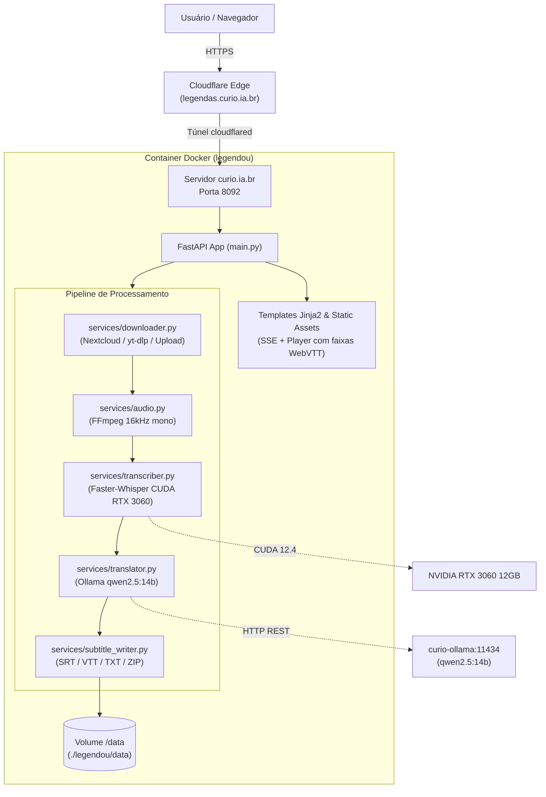

# Legendou 🎙️🎬

> **Serviço Online de Transcrição, Tradução e Legendagem de Vídeo e Áudio com Inteligência Artificial**  
> Hospedado no servidor `curio.ia.br` • Grupo de Pesquisas Curió

---

## 1. Visão Geral

O **Legendou** é uma plataforma web completa e de alto desempenho que automatiza a geração de legendas sincronizadas e transcrições em múltiplos idiomas a partir de links remotos ou arquivos locais de áudio e vídeo.

### Destaques e Capacidades:
- **Ingestão Versátil de Mídia**:
  - **Nextcloud**: Reconhece links públicos (`https://nuvem.curio.ia.br/s/...`), resolve redirecionamentos WebDAV e baixa o arquivo original diretamente.
  - **YouTube & Streaming**: Baixa áudio otimizado de URLs suportadas via `yt-dlp`.
  - **Links Diretos**: Download HTTP/HTTPS com barra de progresso.
  - **Upload Local pelo Navegador**: Suporta arquivos de **Vídeo** (`.mp4`, `.mov`, `.mkv`, `.webm`, `.avi`) e **Áudio** (`.mp3`, `.wav`, `.m4a`, `.ogg`, `.flac`, `.aac`).
- **Aceleração por Hardware (GPU NVIDIA RTX 3060 12GB)**:
  - Transcrição com `faster-whisper` em CUDA `float16`.
  - Vídeos de 15 a 20 minutos são transcritos em **menos de 30 segundos**.
- **Tradução Multilíngue Contextual Local**:
  - Integração com o servidor **Ollama** local (`http://curio-ollama:11434`) usando o modelo `qwen2.5:14b`.
  - Mantém a correspondência temporal exata dos códigos de tempo (milissegundo a milissegundo).
- **Quatro Formatos Simultâneos Gerados por Idioma**:
  1. `*.srt` — SubRip clássico para players (VLC, YouTube, Premiere, etc.).
  2. `*.vtt` — WebVTT para web e players HTML5.
  3. `*_com_tempo.txt` — Roteiro/ata com minutagem (`[00:01:23] Fala...`).
  4. `*_texto_corrido.txt` — Prosa limpa em parágrafos, sem códigos numéricos de tempo.
  5. `*.zip` — Pacote único para download de todos os arquivos.
- **Interface Reativa**:
  - Acompanhamento do progresso em tempo real via **Server-Sent Events (SSE)**.
  - Player integrado HTML5 de vídeo e áudio com legendas embutidas selecionáveis.
  - Botão de cópia rápida com um clique para qualquer visualização.

---

## 2. Arquitetura do Sistema



---

## 3. Estrutura de Arquivos e Diretórios

```text
legendou/
├── Dockerfile                   # Build Ubuntu 22.04 + CUDA 12.4 + cuDNN + FFmpeg
├── requirements.txt             # Dependências Python
├── config.py                    # Variáveis de ambiente, diretórios e modelos
├── main.py                      # Rotas FastAPI, gerenciamento de filas e SSE
├── services/
│   ├── __init__.py
│   ├── downloader.py            # Módulo de download (Nextcloud, YouTube, HTTP)
│   ├── audio.py                 # Extração/normalização de áudio via FFmpeg
│   ├── transcriber.py           # Transcrição Faster-Whisper GPU/CPU
│   ├── translator.py            # Tradução estruturada em JSON via Ollama
│   └── subtitle_writer.py       # Gerador de arquivos SRT, VTT, TXT e ZIP
├── templates/
│   ├── index.html               # Página inicial (formulário, abas e histórico)
│   └── job.html                 # Página de progresso, player e visualizador de legendas
├── static/
│   ├── css/
│   │   └── style.css            # Estilo responsivo (identidade visual Curió)
│   └── js/
│       ├── app.js               # Validação de formulários e envio AJAX
│       └── job.js               # Conexão SSE, player de vídeo e cópia de texto
├── data/                        # Diretório persistente de jobs (criado automaticamente)
│   └── <job_id>/                # Pasta individual por tarefa processada
└── README.md                    # Esta documentação
```

---

## 4. Variáveis de Ambiente (`config.py`)

| Variável | Padrão | Descrição |
|---|---|---|
| `PORT` | `8000` | Porta interna do servidor Uvicorn no container |
| `DATA_DIR` | `/data` | Caminho de armazenamento dos jobs, áudios e legendas |
| `OLLAMA_HOST` | `http://curio-ollama:11434` | URL do servidor Ollama para traduções |
| `DEFAULT_WHISPER_MODEL` | `large-v3` | Modelo padrão do Whisper (`large-v3`, `medium`, `small`, `base`) |
| `DEFAULT_TRANSLATION_MODEL` | `qwen2.5:14b` | Modelo do Ollama usado para tradução |
| `DEFAULT_DEVICE` | `cuda` | Dispositivo de inferência (`cuda` ou `cpu`) |
| `DEFAULT_COMPUTE_TYPE` | `float16` | Tipo numérico para GPU (`float16`) ou CPU (`int8`) |

---

## 5. Como Executar e Gerenciar

### 5.1. No Servidor de Produção (`curio.ia.br`)

O serviço está configurado no arquivo `/home/braga/servidor/docker-compose.yml`.

```bash
# Entrar no diretório do servidor
cd /home/braga/servidor

# Iniciar o container em segundo plano
docker compose up -d legendas

# Ver logs em tempo real
docker compose logs -f legendas

# Reiniciar o serviço
docker compose restart legendas

# Reconstruir a imagem Docker após alterações
docker compose build legendas
docker compose up -d legendas
```

### 5.2. Executar Localmente em Outro Computador (Desenvolvimento)

#### Opção A: Com Python e `uv` (Sem Docker)
Requisitos: Python 3.10+, FFmpeg instalado no sistema.

```bash
# 1. Clonar ou copiar a pasta legendou
cd legendou

# 2. Criar ambiente virtual e instalar dependências
pip install -r requirements.txt

# 3. Configurar variáveis para ambiente local
export OLLAMA_HOST="http://localhost:11434"
export DEFAULT_DEVICE="cpu"  # ou cuda se tiver placa Nvidia

# 4. Rodar o servidor FastAPI com hot-reload
python3 -m uvicorn main:app --host 0.0.0.0 --port 8092 --reload
```
Acesse: `http://localhost:8092`.

#### Opção B: Com Docker Local
```bash
# Build e execução com suporte a GPU
docker build -t legendou .
docker run -d --name legendou \
  --gpus all \
  -p 8092:8000 \
  -v $(pwd)/data:/data \
  legendou
```

---

## 6. Endpoints da API REST

| Método | Rota | Descrição |
|---|---|---|
| `GET /` | `/` | Página principal de envio e histórico |
| `POST /` | `/api/jobs` | Cria uma nova tarefa de transcrição (aceita form-data com `media_url` ou upload `file`) |
| `GET /` | `/jobs/{job_id}` | Página de status da tarefa com player e visualizador |
| `GET /` | `/api/jobs/{job_id}/stream` | Stream SSE com progresso em tempo real |
| `GET /` | `/api/jobs/{job_id}/download/{filename}` | Download de um arquivo gerado específico |
| `GET /` | `/api/jobs/{job_id}/media` | Stream do áudio/vídeo original para o player HTML5 |

---

## 7. Ativação do Domínio Público (`legendas.curio.ia.br`)

A rota já está configurada em `/home/braga/servidor/cloudflared-config-www.yml`:
```yaml
  # legendas.curio.ia.br (Sistema de Transcrição e Legendagem Online)
  - hostname: legendas.curio.ia.br
    service: http://localhost:8092
  - hostname: www.legendas.curio.ia.br
    service: http://localhost:8092
```

Para aplicar a nova rota no Cloudflare Tunnel de produção:
```bash
sudo cp /home/braga/servidor/cloudflared-config-www.yml /etc/cloudflared/config.yml
sudo systemctl restart cloudflared
```

---

## 8. Troubleshooting e Manutenção

1. **Verificar uso da GPU**:
   ```bash
   docker exec legendou nvidia-smi
   ```
2. **Verificar se o Ollama está respondendo**:
   ```bash
   docker exec legendou curl -s http://curio-ollama:11434/api/tags
   ```
3. **Limpeza de arquivos antigos**:
   Os jobs ficam armazenados em `/home/braga/servidor/legendou/data/<job_id>`. Para liberar espaço de vídeos pesados após o download das legendas, os arquivos `.MOV` e `.mp4` podem ser removidos mantendo os arquivos leves `.srt`, `.vtt` e `.txt`.
